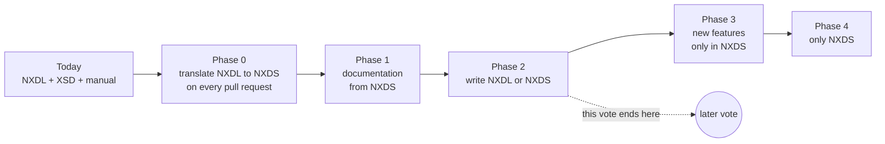

# NXDS: a schema that fully defines NeXus

*A proposal to the NeXus International Advisory Committee (NIAC)*

- **Author:** Wout De Nolf, [ESRF](https://www.esrf.fr), NIAC member
- **Status:** draft for discussion, October 2026
- **Try it:** branch `nxds` of the [definitions repository](https://github.com/nexusformat/definitions). This file is `wip/proposal.md` on that branch. The slides are [`wip/slides/index.html`](slides/index.html).
- Numbers like [#1513](https://github.com/nexusformat/definitions/issues/1513) are issues and pull requests of the definitions repository.

---

## How to read this proposal

**Every section starts with one sentence in bold. Reading only the bold sentences gives the whole story in five minutes.**

| You are … | Read |
|---|---|
| a NIAC member who votes | [1](#1-summary), [2](#2-why-we-want-all-phases), [3](#3-what-we-ask-the-niac-to-vote-on), [8](#8-the-phases-at-a-glance), [10](#10-risks) |
| a scientist who uses NeXus files | [1](#1-summary), [What changes for you](#what-changes-for-you), [5](#5-nexus-in-five-minutes), [9 (phase 1)](#phase-1--nxdemo_phase1-documentation-and-validation) |
| someone who writes NeXus classes | [5](#5-nexus-in-five-minutes), [9](#9-each-phase-with-examples), [11](#11-write-your-first-class) |
| a developer of validators, readers or writers | [7](#7-the-files-at-the-end), [13](#13-developer-part-the-nxds-language), [14](#14-validators-readers-and-writers) |
| new to NeXus | [5](#5-nexus-in-five-minutes) and the [glossary](#glossary) first |

### What changes for you

| You are … | Phases 0–2 (this vote) | At the end (phase 4) |
|---|---|---|
| a scientist with NeXus files | nothing; your files and your software do not change. You get one command to check a file, with the same answer in every tool | the same |
| a facility writing NeXus files | nothing is required. You may check files while they are being written | the same |
| an author of classes | nothing: you keep writing NXDL. A robot adds generated files to your pull request. From phase 2 you *may* write YAML instead | you write YAML |
| a developer of a NeXus tool | nothing breaks. You may read one JSON file per release instead of parsing XML and the manual | you read the JSON files |
| the NIAC | answers 14 questions about rules that are unclear today (one vote each, or grouped) | decides features once, with tests |

## Table of contents

- [1. Summary](#1-summary)
- [2. Why we want all phases](#2-why-we-want-all-phases)
- [3. What we ask the NIAC to vote on](#3-what-we-ask-the-niac-to-vote-on)
- [4. How this proposal was made](#4-how-this-proposal-was-made)
- [5. NeXus in five minutes](#5-nexus-in-five-minutes)
- [6. The problem today](#6-the-problem-today)
- [7. The files at the end](#7-the-files-at-the-end)
- [8. The phases at a glance](#8-the-phases-at-a-glance)
- [9. Each phase with examples](#9-each-phase-with-examples)
- [10. Risks](#10-risks)
- [11. Write your first class](#11-write-your-first-class)
- [12. Questions the NIAC must answer](#12-questions-the-niac-must-answer)
- [13. Developer part: the NXDS language](#13-developer-part-the-nxds-language)
- [14. Validators, readers and writers](#14-validators-readers-and-writers)
- [15. Storage formats](#15-storage-formats)
- [16. Tests that define the meaning](#16-tests-that-define-the-meaning)
- [17. Can NXDS grow in the future?](#17-can-nxds-grow-in-the-future)
- [18. Other options we considered](#18-other-options-we-considered)
- [19. Frequently asked questions](#19-frequently-asked-questions)
- [Glossary](#glossary)
- [Appendix A — How today's tools differ](#appendix-a--how-todays-tools-differ)
- [Appendix B — Example: pull request #1669](#appendix-b--example-pull-request-1669)
- [Appendix C — Warnings about today's classes](#appendix-c--warnings-about-todays-classes)
- [Appendix D — Open issues and pull requests](#appendix-d--open-issues-and-pull-requests)
- [Appendix E — The translation table](#appendix-e--the-translation-table)
- [Appendix F — Sources](#appendix-f--sources)

---

## 1. Summary

**NeXus is a description of how to organise scientific data, but the rules are spread over XML files and normal text. NXDS writes all rules down in one place, in a form programs can read. A working prototype exists. We propose to adopt it step by step, without breaking anything.**

- Today NeXus is described by three things that do not always agree:
  - `nxdl.xsd`, which checks the XML of a *definition file*, not a data file;
  - the definition files (`*.nxdl.xml`), one per class;
  - many rules that are only written as text in the manual.
- Every tool (validators, readers, writers, and our own documentation build) must turn that text into code. They do it differently, so they give different answers about the same file ([Appendix A](#appendix-a--how-todays-tools-differ)).
- **NXDS** (NeXus Definition Schema) is a small language in which every rule is written down. The definitions repository generates, on every pull request, files that say exactly what each class means. Tools in any programming language read those files.
- The change is step by step. Authors notice nothing in phases 0 and 1; in phase 2 they *may* write YAML instead of XML; in phases 3–4 (later votes) NXDS replaces NXDL.
- A prototype on branch `nxds` already translates all 280 classes, generates the files, builds documentation, checks HDF5 files, and has two real classes written in NXDS ([§9](#9-each-phase-with-examples)).

## 2. Why we want all phases

**Each phase helps on its own, but the big gain comes at the end: one simple language that every tool shares. We encourage the NIAC to aim for the end — and to decide each step only after seeing the previous one work.**

| For … | Today | With NXDS (at the end) |
|---|---|---|
| authors of classes | XML with rules you cannot see ("upper case means any name", "in an application definition everything is required unless …") | short YAML where every rule is visible; mistakes are reported with the line number before review |
| people writing data files | different tools give different answers about the same file | one answer, the same in every tool; checks while the file is being written |
| developers of tools | parse XML, read the manual, guess | read one JSON file per release; a test suite says if the tool is right |
| documentation | inherited items often missing | every class shows everything it contains, from the same files the tools use |
| the NIAC | changes to NXDL need changes in every tool; long discussions about what a rule means | a question is answered once, as a test that every tool must pass |
| the future | a new feature needs changes to the XSD, the manual and every tool | a new feature is added once, with a version number; old releases keep working |

What the community asked for:

- "NXDL is a blocker; NYAML helps, but still uncomfortable unconventional rules e.g. PARTIAL names" — [NIAC2026 minutes](https://www.nexusformat.org/NIAC2026_minutes.html), L146
- "cnxvalidate does not recognise partial names"; "cnxvalidate is there but not developed any longer" — [NIAC2026 minutes](https://www.nexusformat.org/NIAC2026_minutes.html), L168, L276
- "mapping to App defs (pydantic model from NXDL)" — [NIAC2026 minutes](https://www.nexusformat.org/NIAC2026_minutes.html), L80
- "github action for checking definitions (and definitions changes) against known example data files" — [NIAC2026 minutes](https://www.nexusformat.org/NIAC2026_minutes.html), L269
- "we have not fully defined the expected behavior of validators" — [Telco 2025-10-20](https://www.nexusformat.org/Telco_20251020.html), L62
- "if we could render inherited optional elements, that would solve quite some resistance towards restructuring" — [Telco 2025-09-16](https://www.nexusformat.org/Telco_20250916.html), L66

Concerns raised in the past, which this proposal must answer:

- "nxdl is our contract; it must stay the single source of truth; nyaml and nxdl shall not coexist" — AB, [Telco 2023-10-19](https://www.nexusformat.org/Telco_20231019.html), L49 → in phases 0–2 NXDL stays the source; from phase 2 each class has exactly one source file (§8).
- "is it our role? we should focus on the definitions" — BW, [Telco 2026-06-10](https://www.nexusformat.org/Telco_20260610.html), L36 → NXDS is about the definitions: it writes their meaning down; the tools only check and publish it.
- "do not make NeXus even more complex" — HB, [Telco 2025-04-30](https://www.nexusformat.org/Telco_20250430.html), L56 → authors see fewer hidden rules, not more (§9, phase 2).
- "NeXus is tied by our limited resources" — BW, [Telco 2022-08-24](https://www.nexusformat.org/Telco_20220824.html), L55 → most of phases 0–2 already works; every phase can stop (§3).
- The nyaml maintainers have not yet been asked about the NXDS file format. Phase 2 waits for their agreement; if there is none within 12 months after the working group's written request, the NIAC decides (§3).

A principle the NIAC holds, and how NXDS keeps it:

> "single source of truth in NeXus is the definition in NXDL. It shall not be the validator which provides the truth. A validator is good, but it should follow the NXDL definitions." — BW, [NIAC2026 minutes](https://www.nexusformat.org/NIAC2026_minutes.html), L277

- In phases 0–2 the definitions stay in NXDL, and the official texts stay the NXDL files and the hand-written text of the manual. The generated files only make the NXDL readable for programs.
- At the end the definitions are written in NXDS instead of NXDL. The principle stays: **the definition is the truth, not the validator**. NXDS even makes this stronger, because the definition then says everything a validator needs, so validators no longer make their own choices. Changing the language of the definitions is exactly what the later votes (phases 3–4) decide.

**History.** In 2007 the NIAC voted that "Version 3.0 will be schema based" ([NIAC2007 minutes](https://www.nexusformat.org/NIAC2007_Minutes.html), L214–230). The tools built then (Schematron, NXvalidate) lived outside the definitions and stopped being maintained; they were removed in 2015. NXDS learns from this: the tools live in the definitions repository and run on every pull request, so they cannot silently fall behind.

**Why not stop after phase 1 or 2?** It is possible, and each phase is a stable state. But stopping means two languages for good: NXDL for authors and NXDS for tools, with a translation between them that must be updated for every language change, and every new feature added twice. At the end the translation still exists, but frozen: it is only used to read old releases. The end state is simpler for everybody.

## 3. What we ask the NIAC to vote on

**We ask the NIAC to agree on the direction and to approve phases 0, 1 and 2. Phases 3 and 4 get their own votes later.**

> The NIAC
>
> 1. agrees that NXDS is the intended direction for defining NeXus. The written specification of NXDS (draft: [`nxds/spec/nxds.md`](../nxds/spec/nxds.md)) is completed during phases 0–2 and adopted by a separate vote before phase 3. The NIAC may stop at any phase.
> 2. approves phases 0, 1 and 2 in the definitions repository, as described in §8 and the decision table below (version of [commit to be filled in when the motion is submitted]); branch `nxds` is a demonstration:
>    - **phase 0:** the tools in `nxds_tools/`; the files in `nxds/generated/`, updated automatically on every pull request; extra checks in CI that report problems but do not block pull requests;
>    - **phase 1:** the class pages of the manual are generated from `nxds/generated/`; values that depend on an unanswered question (§12) are marked as such;
>    - **phase 2:** new classes may also be written in NXDS (YAML), limited to what NXDL can express, so that each one can always be converted back to NXDL. Phase 2 starts only when the NXDS file format is agreed with the nyaml maintainers (or decided by the NIAC as described in the decision table below) and the checkpoint in [§8](#8-the-phases-at-a-glance) is met.
> 3. creates a working group of at least three volunteers, including one maintainer of a validator other than the author's, chaired by a member other than the author. It brings `nxds_tools` into the repository through normal reviewed pull requests, maintains it, reports in writing on the checkpoints, and brings the questions of [§12](#12-questions-the-niac-must-answer) to a vote.

**What item 1 means.** It states where the NIAC wants to go. It does not oblige anyone to anything, does not stop new NXDL features (they still go into NXDL and get a translation rule), and does not decide phases 3–4.

**What is binding and what is illustration.** Binding: the scope of each phase (§3, §8) and the checkpoints (§8). Illustration: the examples (§9), the proposed answers to the questions (§12), the design details (§13–§17) and the measurements (§14.1).

**What the vote does not change:** no existing class, no NXDL rule, no data file. Until the NIAC adopts the specification, the official texts are, in this order: the NXDL files, then the hand-written text of the manual. Generated pages (including the class pages of the manual from phase 1) are not official. Classes written in NXDS (phase 2) are also published as NXDL, so every tool that reads NXDL keeps working.

**About branch `nxds`:** it demonstrates all of phases 0–2 at once, including two real classes (`NXslit`, `NXmonopd`) converted to YAML. That conversion is only a demonstration: the pull request that brings phase 0 to the main branch keeps every class in NXDL, and YAML classes are accepted only when phase 2 starts.

**If the motion is rejected:** nothing changes. Parts can still be proposed alone, for example the extra checks in CI.

**How decisions are taken after the vote:**

| What | How |
|---|---|
| a checkpoint (§8) | the working group sends a written report to the NIAC two weeks before a telco; it is accepted at the telco unless a NIAC member asks for a vote |
| the 14 questions (§12) | the working group drafts one motion per question (or a group of closely related questions; the NIAC chair decides the grouping); normal NIAC voting rules. If a proposed answer is rejected, the working group proposes another answer, or the NIAC votes to leave the question open (tools may then differ on it, and the generated files say so); phase 2 waits until each question is answered or left open |
| impact before each vote | the validator is run on a fixed set of public example files, chosen by the working group before the first vote and published |
| no agreement with the nyaml maintainers within 12 months after the working group's written request | the NIAC decides on the NXDS file format itself |
| stopping or undoing a phase | a NIAC vote, at the request of any member; triggers include: fewer than three working-group members, no second maintainer, or a checkpoint missed by more than a year. Phases 0–2 can be undone technically (§8); answers already voted stay valid |

**Planned dates (targets, not promises; all work is voluntary):**

| Step | Target |
|---|---|
| working group formed | within three months of the vote |
| phase 0 in the main branch | first release of 2027 |
| questions Q1, Q2, Q5 voted | first half of 2027 |
| phase 1 (documentation from NXDS) | second half of 2027 |
| other questions voted | by NIAC2028 |
| agreement on the NXDS file format with the nyaml maintainers | first half of 2028 |
| phase 2 | after that agreement and the votes on Q1–Q14; around NIAC2028 |
| specification adopted; vote on phases 3–4 | not before NIAC2028 |

**Who does the work.** The author volunteers to maintain `nxds_tools`. The working group needs a second maintainer before phase 1 (a checkpoint). The remaining work, all voluntary:

- review and merge `nxds_tools` (about 6 000 lines of Python, written with AI help; reviewed line by line like any contribution, under the repository's licence);
- complete the specification from the draft;
- the 14 question votes and their impact reports;
- a second, independent validator;
- the agreement with the nyaml maintainers.

## 4. How this proposal was made

**This proposal and the prototype were made with the help of AI agents. The author directed the work and is responsible for the result. Review by the community starts now.**

- The author asked an AI assistant (Claude, by Anthropic) to study the problem and propose a solution.
- The assistant used *agents*: separate AI instances, each with one task:
  - **research**: reading the definitions repository (main branch, branches, all 1 676 issues and pull requests), the NeXus [wiki](https://github.com/nexusformat/wiki), seven libraries that use NeXus, and the author's prototype [nexusformat_schemas](https://gitlab.esrf.fr/hdf5/nexus/nexusformat_schemas);
  - **development**: writing `nxds_tools` and the examples on branch `nxds`;
  - **measurement**: building and timing validators, readers and writers on large files ([§14](#14-validators-readers-and-writers));
  - **review**: AI agents playing different readers (from a schema engineer to a first-year PhD student, a reader whose first language is not English, and a NIAC member who doubts the idea) asked questions until they had none left.
- These reviews were AI role-plays, **not** a review by the community. They helped to make the text clearer.
- Facts (issue numbers, quotes, file names, numbers) were checked against the sources. Please report anything that is wrong.
- Background material: [`research-notes.md`](research-notes.md), [`design-decisions.md`](design-decisions.md), [`performance.md`](performance.md).

## 5. NeXus in five minutes

**NeXus says how to organise experimental data in a file. Classes say what a part of the file may or must contain.**

A NeXus file is a tree, like folders and files on a disk:

```
/                         the file
  entry                   a group (like a folder), class NXentry
    definition            a dataset: the text "NXdemo_phase1"
    instrument            a group, class NXinstrument
      monochromator       a group, class NXmonochromator
        energy            a dataset: 200 numbers, attribute units="eV"
    data                  a group, class NXdata, attribute signal="mu"
      mu                  a dataset: 200 numbers
      energy              a link to /entry/instrument/monochromator/energy
```

- **Groups** are like folders. **Datasets** (NXDL calls them *fields*) hold data: a number, a text, or a large array. **Attributes** are small values attached to a group or dataset, like `units="eV"`. **Links** point to another group or dataset.
- NeXus does not depend on one file format: "NeXus is a data format and not a file format" ([Telco 2023-09-20](https://www.nexusformat.org/Telco_20230920.html)). Today almost all NeXus files are HDF5 files.
- Every group has a **class**, stored in the attribute `NX_class`. A class says what such a group may contain:
  - a **base class** says what a group of one kind *may* contain. Example: `NXmonochromator` may contain `energy`. Everything is optional. There are 195 base classes.
  - an **application definition** says what a file for one technique *must* contain. Example: a tomography file must contain detector data and rotation angles. There are 85.
- Each class has a **category**: `base` or `application`.
- A measurement is stored in an `NXentry` group. Its dataset `definition` says which application definition the entry follows.
- Some names are free: an entry may be called `entry`, `scan_12` or anything. Some are partly free: `AXISNAME_indices` matches `x_indices`, `energy_indices`, …
- A **data type** says what kind of value a dataset holds (`NX_FLOAT` for numbers with decimals, `NX_CHAR` for text, …). A **units category** says what kind of unit (`NX_ENERGY` for `eV`, `keV`, …).
- A **symbol** gives a name to a length that several arrays share (`nE` = number of energies).
- Classes inherit from other classes (`extends`). `NXobject` is the class every base class inherits from; `NXroot` is the class of the file itself.
- The **NIAC** decides about NeXus. It meets in person every two years and has a telephone meeting ("telco") about every month. Classes are developed on [GitHub](https://github.com/nexusformat/definitions).

## 6. The problem today

**The rules that say what a correct NeXus file is are spread over XML files and normal text. Tools read the text differently. The examples below are not a complete list.**

### 6.1 What programs can read, and what not

| Rule | Where it is written today | Can a program check a data file with it? |
|---|---|---|
| which XML elements a definition file may contain | `nxdl.xsd` | no: it checks the definition file, not the data file |
| data types, units categories, allowed names | `nxdl.xsd`, `nxdlTypes.xsd` | partly |
| what is required in an application definition, what is optional in a base class | manual | no |
| how many groups of one kind a file may contain; what `optional` and `recommended` mean | manual, sometimes saying different things ([#1513](https://github.com/nexusformat/definitions/issues/1513), [#1636](https://github.com/nexusformat/definitions/issues/1636)) | no |
| how free and partly free names work | manual, XSD comments | no |
| what a class may change in what it inherits | manual ([#1058](https://github.com/nexusformat/definitions/issues/1058), [#1059](https://github.com/nexusformat/definitions/issues/1059)) | no |
| `NX_class`, `@units`, `@target`, the `definition` dataset | manual ([#1493](https://github.com/nexusformat/definitions/issues/1493), [#1558](https://github.com/nexusformat/definitions/issues/1558), [#1668](https://github.com/nexusformat/definitions/issues/1668)) | no |
| whether array shapes in a class are a rule or an example | nowhere ([#1508](https://github.com/nexusformat/definitions/issues/1508)) | no |
| how to find the default plot (`@default`, `@signal`, `@axes`) | manual | no |
| what a validator reports, and how serious it is | nowhere | no |

The manual and the XSD also say different things in places. Example: the manual says "all terms in an application definition are required", the XSD says attributes are optional unless marked.

### 6.2 What goes wrong

- **Tools give different answers about the same file.** Example: is `x1_indices` a correct name for `AXISNAME_indices`? pynxtools says yes, nexusformat says no, cnxvalidate and punx do not support free names. More in [Appendix A](#appendix-a--how-todays-tools-differ). Users reported such problems ([#600](https://github.com/nexusformat/definitions/issues/600), [#1184](https://github.com/nexusformat/definitions/issues/1184), [#1508](https://github.com/nexusformat/definitions/issues/1508)).
- **Our documentation build has its own copy of the rules** (`dev_tools/docs/nxdl.py`), and it does not show inherited items.
- **Our CI only checks that definition files are correct XML.** It does not check that a parent class exists, that a link points to something, or that a symbol is declared. Under the proposed rules the prototype reports 430 warnings for today's classes ([Appendix C](#appendix-c--warnings-about-todays-classes)).
- **Many changes to NXDL need changes in every tool.** `choice`, `recommended`, `nameType`, open lists of values and `NXobject` inheritance each did. [Appendix B](#appendix-b--example-pull-request-1669) shows this for a current pull request.

### 6.3 What was tried before

- XML Schemas and Schematron for data files (2009–2015: [#15](https://github.com/nexusformat/definitions/issues/15), [#33](https://github.com/nexusformat/definitions/issues/33), [#66](https://github.com/nexusformat/definitions/issues/66), [#87](https://github.com/nexusformat/definitions/issues/87)). Removed in 2015.
- The NeXus Ontology ([#922](https://github.com/nexusformat/definitions/issues/922)): it "describes, does not define" the standard.
- nyaml ([#1282](https://github.com/nexusformat/definitions/issues/1282), [#1303](https://github.com/nexusformat/definitions/issues/1303)): YAML instead of XML, but with the same hidden rules.
- A separate tool that reads the XSD (the author's [nexusformat_schemas](https://gitlab.esrf.fr/hdf5/nexus/nexusformat_schemas)): it works, but must be changed every time the XSD or the manual changes.

All of these kept the meaning outside the definitions repository. NXDS puts it inside.

## 7. The files at the end

**At the end, people edit only the class files (YAML) and the specification. Everything else is generated, and tools only read the generated files.**

```
definitions/
├── base_classes/NXmonochromator.nxds.yaml     ✍ written by people
├── applications/NXtomo.nxds.yaml              ✍ written by people
├── contributed_definitions/*.nxds.yaml        ✍ written by people
├── nxds/
│   ├── spec/                                  ✍ the NXDS specification (Markdown; part of the manual)
│   ├── conformance/                           ✍ tests: small inputs with the expected answer
│   └── generated/                             ⚙ generated on every pull request
│       ├── index.json                             data types, units, names, storage formats, list of classes
│       ├── resolved/NXmonochromator.json          what each class means, with inheritance applied
│       ├── schema/*.json                          the format of the class files and generated files
│       └── report.txt                             warnings about the classes
├── nxds_tools/                                ✍ the Python tools: build, check, documentation, a reference validator
└── manual/                                    ✍ the manual; class pages generated from nxds/generated
```

| File | Edited by | Generated by | Used by |
|---|---|---|---|
| `*.nxds.yaml` | authors of classes | — | `nxds_tools` |
| `nxds/spec/` | the NIAC, by vote | — | everybody who builds an NXDS tool |
| `nxds/conformance/` | the working group | — | tool developers, to test their tool |
| `nxds/generated/` | nobody (a robot) | a robot on every pull request (or `make nxds`) | validators, readers, writers, documentation, ontology |
| one file per release (`nxds-<release>.zip`) | nobody | the release | tools that want one file |
| class pages of the manual | nobody | `nxds_tools docs` | readers of the documentation |

**What an author does in a pull request:** edit a class file and open the pull request. A robot (a GitHub Action) runs `make nxds` and adds the updated generated files to the pull request. GitHub does not let robots change pull requests that come from a fork; then the robot attaches a patch that the author or a maintainer may apply. If a pull request is merged without it, the robot opens a small follow-up pull request with the updated files. Nobody needs Python to contribute. Reviewers then see, line by line, what changed in the meaning of each class. Authors who want to check locally run `make nxds` themselves.

**When are `nxdl.xsd` and the `*.nxdl.xml` files removed?** In phase 4, after a vote. One pull request converts all `*.nxdl.xml` files to `*.nxds.yaml`; `nxdl.xsd` and `nxdlTypes.xsd` are deleted from the main branch. They stay in the git history and in old releases, and `nxds_tools` keeps the translation so it can read old releases.

**What does a release contain in phases 2–3?** The class files as written (NXDL or NXDS), plus an NXDL version of every class written in NXDS, so tools that read NXDL find every class where they expect it.

## 8. The phases at a glance

**Five phases. Nothing breaks in phases 0–2: authors may keep writing NXDL, and tools that read NXDL keep working.**

| Phase | What changes | Authors write | Tools read | Vote | Main risks |
|---|---|---|---|---|---|
| **0 Translate** | NXDL is translated to NXDS on every pull request; extra checks in CI | NXDL | NXDL, or the new files | this motion | [R1](#r1), [R6](#r6), [R11](#r11) |
| **1 Document** | the class pages of the manual are generated from the new files | NXDL | NXDL, or the new files | this motion | [R2](#r2), [R3](#r3), [R12](#r12) |
| **2 Choose** | a class may be written in NXDS or in NXDL | NXDL or NXDS | NXDL, or the new files | this motion | [R4](#r4), [R5](#r5), [R13](#r13), [R14](#r14) |
| **3 Grow** | new features only in NXDS; `nxdl.xsd` does not change any more | NXDL or NXDS; new features need NXDS | the new files (NXDL still published) | later | [R7](#r7) |
| **4 Finish** | all classes in NXDS; XSD and NXDL removed | NXDS | the new files | later | [R7](#r7), [R8](#r8), [R15](#r15) |



**Checkpoints.** Before a phase starts, these must be true. The working group checks them and sends a written report to the NIAC two weeks before a telco.

| Before | Must be true |
|---|---|
| phase 1 | every class is translated; every translation rule has a test; the working group has written down, rule by rule, how it compares with the manual; questions Q1, Q2 and Q5 (which decide what the documentation calls required) are answered — they cannot be left open; a second maintainer of `nxds_tools` |
| phase 2 | the questions in §12 are answered or voted to be left open; the documentation generated from NXDS is used in a release; two validators from different people pass the tests (if nobody writes the second one, phase 2 waits); the NXDS file format is agreed with the nyaml maintainers, or decided by the NIAC as described in §3 |
| phase 3 | at least ten classes are written in NXDS; their generated NXDL passes the tests of the tools listed in Appendix A that are still maintained; the specification is adopted |
| phase 4 | the main tools read the new files, or their maintainers agree; the NIAC sets a date after which NXDL is no longer published |

**Undoing a phase.** Phases 0–2 can be undone: the generated folder can be removed, the documentation can be built from NXDL again, and every class written in NXDS can be converted back to NXDL without loss (this is checked on every pull request).

## 9. Each phase with examples

**One small, made-up example runs through all phases: an application definition (`NXdemo_…`) and a base class it uses (`NXdemo_counter_…`). For each phase we show what a person writes and what is generated.**

All files are on branch `nxds` in [`wip/examples/`](examples/README.md). The example: the absorption coefficient `mu` of a sample is measured for `nE` energies of a monochromator; a counter counts the incoming beam (`i0_counts`). It is not taken from a real application definition.

### Today — `NXdemo_today`, written in NXDL

**What the author writes** ([`today/`](examples/today/)). The base class:

```xml
<definition name="NXdemo_counter_today" extends="NXobject" type="group" category="base"
            xmlns="http://definition.nexusformat.org/nxdl/3.1">
  <doc>Demo: a counter with several channels.</doc>
  <field name="mode">
    <enumeration><item value="timer"/><item value="monitor"/></enumeration>
  </field>
  <field name="CHANNEL_counts" nameType="partial" type="NX_INT" units="NX_COUNT"/>
  <group type="NXsensor"/>
</definition>
```

The application definition:

```xml
<definition name="NXdemo_today" extends="NXobject" type="group" category="application"
            xmlns="http://definition.nexusformat.org/nxdl/3.1">
  <symbols><symbol name="nE"><doc>number of energies</doc></symbol></symbols>
  <doc>Demo: absorption against energy.</doc>
  <group type="NXentry">
    <field name="definition"><enumeration><item value="NXdemo_today"/></enumeration></field>
    <field name="title" recommended="true"/>
    <group type="NXinstrument">
      <group name="monochromator" type="NXmonochromator">
        <field name="energy" type="NX_FLOAT" units="NX_ENERGY">
          <dimensions rank="1"><dim index="1" value="nE"/></dimensions>
        </field>
      </group>
      <group name="counter" type="NXdemo_counter_today">
        <field name="mode"/>
        <field name="i0_counts"><dimensions rank="1"><dim index="1" value="nE"/></dimensions></field>
      </group>
    </group>
    <group type="NXdata">
      <attribute name="signal"><enumeration><item value="mu"/></enumeration></attribute>
      <field name="mu" type="NX_FLOAT"><dimensions rank="1"><dim index="1" value="nE"/></dimensions></field>
      <link name="energy" target="/NXentry/NXinstrument/monochromator:NXmonochromator/energy"/>
    </group>
  </group>
</definition>
```

**What a reader must know, but cannot see in the file:**

- groups without a name (`NXentry`, `NXinstrument`, `NXdata`) may have any name in the data file;
- `CHANNEL_counts` with `nameType="partial"` means `i0_counts`, `i1_counts`, …, and `i0_counts` in the application definition is one of them;
- in an application definition everything is required unless marked — but does that include the attribute `signal`? The XSD says attributes are optional;
- must `mu` and `energy` have the same length, or is `nE` only an example?

**What is generated:** nothing. Every tool answers these questions in its own way.

### Phase 0 — `NXdemo_phase0`: NXDL is translated automatically

**The author writes exactly the same NXDL as today** ([`phase0/`](examples/phase0/)). Nothing changes for authors; a robot adds the generated files to the pull request.

**What is generated** (people do not need to read these files; tools and reviewers do):

1. **The class translated to NXDS** ([`generated/source/NXdemo_phase0.nxds.yaml`](examples/phase0/generated/source/NXdemo_phase0.nxds.yaml)). Each value says which translation rule produced it (`via`) and which open question it depends on (`provisional`):

   ```yaml
   children:
     ENTRY:
       node: group
       name: {any: true}        # "no name" in NXDL, written out: any name
       class: NXentry
       children:
         title:
           node: dataset
           occurs: {min: 0}
           recommended: true
           via: [T0, T1, T6, T7]
           provisional: [Q1]
   ```

2. **What the class means** ([`generated/resolved/NXdemo_phase0.json`](examples/phase0/generated/resolved/NXdemo_phase0.json)), one item per line, so a pull request shows exactly what changed:

   ```json
   {"id": "ENTRY", "class": "NXentry", "name": {"any": true}, "occurs": {"min": 1, "max": "unbounded"},
    "declared_by": "NXroot", "refined_by": ["NXdemo_phase0"], "specialisation": "NXdemo_phase0/ENTRY"}
   {"ref": "NXentry/start_time", "node": "dataset"}
   ```

   | Key | Meaning |
   |---|---|
   | `occurs` | how many: at least `min`, at most `max` |
   | `declared_by` | the class that first declared the item |
   | `refined_by` | the classes that made it more precise |
   | `specialisation` | where the application definition's version of this group is described |
   | `ref` | an inherited item that this class does not change; it is described in full in `NXentry` |

3. **A report** with warnings about the classes ([`generated/report.txt`](examples/phase0/generated/report.txt)).

The base class `NXdemo_counter_phase0` is treated the same way.

**In the real repository (prototype):** all 280 classes are translated in about 4 seconds, without errors. CI fails if the generated files do not match the classes; the robot keeps them up to date ([`.github/workflows/nxds.yaml`](../.github/workflows/nxds.yaml)).

### Phase 1 — `NXdemo_phase1`: documentation and validation

**The author writes NXDL as before** ([`phase1/`](examples/phase1/)).

**New:**

- **Documentation.** The class page of the manual is generated ([`generated/rst/NXdemo_phase1.rst`](examples/phase1/generated/rst/NXdemo_phase1.rst)). It shows every item, also inherited ones ("inherited from NXentry"), and says whether it is required, recommended or optional. Values that depend on an unanswered question are marked.
- **Checking a file.** After `make install` on branch `nxds`, one command checks a file (a package installable with `pip` is planned):

  ```
  python -m nxds_tools validate demo_phase1.h5 --bundle nxds/generated
  ```

  For this file, where `data` has no `@signal` and the entry has no `title`:

  ```
  /                     @NX_class=NXroot
    entry               @NX_class=NXentry
      definition        "NXdemo_phase1"
      instrument        @NX_class=NXinstrument
        monochromator   @NX_class=NXmonochromator
          energy        200 numbers, @units="eV"
        counter         @NX_class=NXdemo_counter_phase1
          mode          "timer"
          i0_counts     200 integers, @units=""   (counts have no unit; "" is accepted)
      data              @NX_class=NXdata
        mu              200 numbers
        energy          link to /entry/instrument/monochromator/energy
  ```

  the result is:

  ```
  WARNING /entry: a recommended item is missing (NXdemo_phase1/ENTRY/title)
  ERROR   /entry/data: a required item is missing (NXdemo_phase1/ENTRY/DATA@signal)
  ```

  `ERROR` means "the file does not follow the definition"; `WARNING` means "it follows the definition, but have a look". The `ERROR` depends on question Q2 (are attributes required?). With `--json` the same result is written for programs, one line per message ([`generated/findings.jsonl`](examples/phase1/generated/findings.jsonl)).

- **Checking a file while it is being written.** After 57 of 200 points, *partial mode* (`--partial`) only says what is not finished, as information:

  ```
  INFO    /entry: not finished yet (NXdemo_phase1/ENTRY#nE) — mu and i0_counts have 57 values, energy 200
  INFO    /entry: not finished yet (NXdemo_phase1/ENTRY/title)
  INFO    /entry/data: not finished yet (NXdemo_phase1/ENTRY/DATA@signal)
  ```

  `#nE` means "the length called `nE`". Such a check takes 3–5 ms.

### Phase 2 — `NXdemo_phase2`: authors may write NXDS

**The author may now write YAML instead of XML** ([`phase2/`](examples/phase2/)). Every rule is in the file.

The base class ([`NXdemo_counter_phase2.nxds.yaml`](examples/phase2/NXdemo_counter_phase2.nxds.yaml)):

```yaml
nxds: "0.1"
class: NXdemo_counter_phase2
category: base
extends: NXobject
doc: "Demo: a counter with several channels."
defaults: {min: 0, binding: false}   # everything optional; shapes are only examples
children:
  mode:                               # FIXED name: the file must call it "mode"
    node: dataset
    type: NX_CHAR
    enum: [timer, monitor]
  CHANNEL_counts:                     # PARTLY FREE name: i0_counts, i1_counts, …
    node: dataset
    name: {template: "{CHANNEL}_counts"}
    type: NX_INT
    units: {category: NX_COUNT}
  SENSOR:                             # FREE name: any name
    node: group
    class: NXsensor
    name: {any: true}
```

The application definition ([`NXdemo_phase2.nxds.yaml`](examples/phase2/NXdemo_phase2.nxds.yaml)):

```yaml
nxds: "0.1"
class: NXdemo_phase2
category: application
describes: NXroot                   # an application definition describes a whole file
doc: "Demo: absorption against energy."
defaults: {min: 1, binding: true}   # everything required unless written otherwise; shapes are rules
symbols:
  nE: {doc: number of energies}
children:
  ENTRY:
    node: group
    class: NXentry
    name: {any: true}               # free name
    children:
      definition: {node: dataset, type: NX_CHAR, enum: [NXdemo_phase2]}
      title: {node: dataset, type: NX_CHAR, occurs: {min: 0}, recommended: true}
      INSTRUMENT:
        node: group
        class: NXinstrument
        name: {any: true}
        children:
          monochromator:            # fixed name
            node: group
            class: NXmonochromator
            children:
              energy: {node: dataset, type: NX_FLOAT, units: {category: NX_ENERGY}, shape: [nE]}
          counter:
            node: group
            class: NXdemo_counter_phase2
            children:
              mode: {node: dataset}                     # keeps type and values of the base class
              i0_counts: {node: dataset, shape: [nE]}   # one of {CHANNEL}_counts of the base class
      DATA:
        node: group
        class: NXdata
        name: {any: true}
        attributes:
          signal: {type: NX_CHAR, enum: [mu]}
        children:
          mu: {node: dataset, type: NX_FLOAT, shape: [nE]}
          energy: {node: link, target: ENTRY/INSTRUMENT/monochromator/energy}
```

**How to read it:**

| Written | Meaning |
|---|---|
| a key like `mode:` or `ENTRY:` | a label for the item, chosen by the author. Without `name:` it is also the name in the file |
| `name: {any: true}` | the file may use any name. Upper-case labels (`ENTRY`) are only a habit that helps readers see this |
| `name: {template: "{CHANNEL}_counts"}` | the file may use names like `i0_counts`; `{CHANNEL}` is the free part |
| `defaults: {min: 1, binding: true}` | `min: 1`: every item is required unless it says `occurs: {min: 0}`. `binding: true`: array shapes like `[nE]` are rules, not examples |
| `describes: NXroot` | an application definition describes a whole file (`NXroot` is the class of the file) |
| `target: ENTRY/INSTRUMENT/monochromator/energy` | the link must point to that item; written with the labels, not with names from a file |

**What is generated:** what the classes mean (the same as for the NXDL version: a test checks this), and an NXDL version of both files ([`generated/legacy/`](examples/phase2/generated/legacy/)) for tools that read NXDL.

**In the real repository (prototype):** `base_classes/NXslit.nxds.yaml` and `applications/NXmonopd.nxds.yaml` are written in NXDS. `NXxrd` (still NXDL) extends `NXmonopd` (now NXDS): both languages work together. The manual builds as before, from the generated NXDL.

### Phase 3 — `NXdemo_phase3`: a feature NXDL cannot express

**The author needs "at least one of `mu` or `fluo`" ([#1045](https://github.com/nexusformat/definitions/issues/1045), [#1002](https://github.com/nexusformat/definitions/issues/1002), [#1064](https://github.com/nexusformat/definitions/issues/1064)). NXDL cannot say this; NXDS can** ([`phase3/`](examples/phase3/)):

```yaml
      DATA:
        node: group
        class: NXdata
        name: {any: true}
        attributes:
          signal: {type: NX_CHAR, enum: [mu, fluo]}
        children:
          mu:   {node: dataset, type: NX_FLOAT, shape: [nE], occurs: {min: 0}}
          fluo: {node: dataset, type: NX_FLOAT, shape: [nE], occurs: {min: 0}}
        require:
          at_least_one_of: [mu, fluo]
```

The base class does not change. The NXDL version makes both datasets optional and mentions the rule only in its text. The generated files mark the class as `lossy` ("one rule is lost in the NXDL version"), so tools that read NXDL know they miss a rule.

### Phase 4 — `NXdemo_phase4`: only NXDS

**The same YAML as in phases 2–3; every class of the repository is now YAML** ([`phase4/`](examples/phase4/README.md)). No NXDL is published any more; `nxdl.xsd` is removed from the main branch. CI checks the class files, generates `nxds/generated/`, runs the tests and builds the documentation.

## 10. Risks

**Each risk has a number (R1 …), used in the rest of the document.**

| | Risk | What we do about it |
|---|---|---|
| <a id="r1"></a>**R1** | Too few volunteers; the work depends on one person | a working group of at least three; a second maintainer before phase 1 (checkpoint); most of phases 0–2 already works in the prototype; phases 0–2 can be undone |
| <a id="r2"></a>**R2** | When the NIAC answers a question of §12, some existing files get a different result in some tools | your files are not changed and your software reads them as before. Before each vote, the validator is run on public example files and the result is shown. A file can always be checked against the release it was written with |
| <a id="r3"></a>**R3** | The generated documentation differs from today's | a tool compares the documentation of two versions ([#1650](https://github.com/nexusformat/definitions/pull/1650), `make docdiff`); every difference is checked |
| <a id="r4"></a>**R4** | A new file format next to NXDL and nyaml confuses people | phase 2 starts only after the format is agreed with the nyaml maintainers; each class exists in exactly one file (CI checks this) |
| <a id="r5"></a>**R5** | The work stops halfway, leaving two languages | each phase is a stable state; phases 0–2 can be undone; progress is reported at the telcos |
| <a id="r6"></a>**R6** | `nxds_tools` is new software to maintain | it is about 6 000 lines of Python, tested, and replaces the rules now copied in `dev_tools`; the author maintains it, with the working group |
| <a id="r7"></a>**R7** | Tools that only read NXDL miss new features (phase 3) | such classes are marked `lossy`; NXDL is published until a date the NIAC sets |
| <a id="r8"></a>**R8** | Other tools do not switch | NXDL stays available until phase 4; the new files are easier to use than NXDL ([§14](#14-validators-readers-and-writers)); the tests let anyone show their tool is correct |
| <a id="r9"></a>**R9** | The specification itself causes long discussions | a disagreement becomes a test that the NIAC votes on once, instead of tools that silently differ |
| <a id="r10"></a>**R10** | Files that do not say which NeXus release they used are checked with a newer release | the user can choose the release; writers are asked to record it (`NXroot/@NeXus_release`) |
| <a id="r11"></a>**R11** | Authors must run a Python tool for every pull request | a robot updates the generated files in the pull request; for pull requests from forks it attaches a patch (applying it is optional), and after merging it opens a follow-up pull request that a maintainer merges; this needs the repository setting "Allow GitHub Actions to create pull requests"; authors only edit class files |
| <a id="r12"></a>**R12** | The documentation shows rules the NIAC has not voted on | values that depend on an unanswered question are marked in the documentation; the manual stays the official text |
| <a id="r13"></a>**R13** | Classes are written in YAML (phase 2) before the specification is adopted | phase 2 classes are limited to what NXDL can express and are also published as NXDL, so their meaning is the meaning of that NXDL; the specification is adopted before phase 3 |
| <a id="r14"></a>**R14** | A split with the nyaml / FAIRmat community | phase 2 waits for an agreement on the file format; if there is none within 12 months, the NIAC decides, which can leave two YAML formats side by side; nyaml files keep working through NXDL in any case |
| <a id="r15"></a>**R15** | At the end (phase 4), maintainers of tools that read NXDL must switch | NXDL is published until a date the NIAC sets; the new files are simpler to read; the work is announced years ahead |

## 11. Write your first class

**Copy an example, change it, check it, open a pull request.**

1. **Get the tools.** In a copy of the [definitions repository](https://github.com/nexusformat/definitions): `git checkout nxds` (until the motion is accepted, the tools only exist on this branch), then `make install`.
2. **Choose the language.**
   - **Today (phases 0–1): write NXDL.** Copy [`examples/today/NXdemo_counter_today.nxdl.xml`](examples/today/NXdemo_counter_today.nxdl.xml) (a base class) or [`NXdemo_today.nxdl.xml`](examples/today/NXdemo_today.nxdl.xml) (an application definition) into a folder, for example `my_classes/`.
   - **From phase 2: you may write YAML.** Copy [`examples/phase2/NXdemo_counter_phase2.nxds.yaml`](examples/phase2/NXdemo_counter_phase2.nxds.yaml) or [`NXdemo_phase2.nxds.yaml`](examples/phase2/NXdemo_phase2.nxds.yaml) instead. You can already try YAML on branch `nxds`, but pull requests with YAML classes are accepted only from phase 2.
3. **Change it.** Rename the class (the name inside the file and the file name). In YAML, use `defaults: {min: 0, binding: false}` for a base class and `defaults: {min: 1, binding: true}` for an application definition. Add your items. To see what a base class like `NXmonochromator` already contains, open its page in the [manual](https://manual.nexusformat.org/classes/base_classes/index.html) (from phase 1 the page shows inherited items too). Data types and units categories are listed in the manual's page on [types and units](https://manual.nexusformat.org/nxdl-types.html).
4. **Check it:**

   ```
   python -m nxds_tools check --definitions . --extra my_classes/
   ```

   A message looks like this (NXDL files get line numbers too):

   ```
   WARNING [undeclared-symbol] my_classes/NXmy_furnace.nxds.yaml:12: symbol 'nT' is not declared
   ```

5. **Check a data file against it:**

   ```
   python -m nxds_tools build --definitions . --extra my_classes/ --out /tmp/mybundle
   python -m nxds_tools validate myfile.h5 --bundle /tmp/mybundle
   ```

6. **Open a pull request** in the [definitions repository](https://github.com/nexusformat/definitions), in `contributed_definitions/`. From phase 0 a robot adds the generated files; reviewers comment; the NIAC decides when a class is ready to move to `base_classes/` or `applications/`.

## 12. Questions the NIAC must answer

**The manual leaves these questions open, or answers them in different ways in different places. The prototype uses the proposed answer and marks every value that depends on it. The NIAC answers each question once, by vote; the answer then becomes a test.**

| | Question | Proposed answer |
|---|---|---|
| **Q1** | When a class does not say how many, how many items may a file contain? | one for a fixed name, any number for a free name |
| **Q2** | In an application definition, are attributes and links required when nothing is written? | yes |
| **Q3** | Which characters may the free part of a partly free name contain? | letters, digits, `_` and `.`; at least one |
| **Q4** | What may a class change in what it inherits? | it may make things more precise; replacing a list of values gives a warning |
| **Q5** | Are array shapes in a class rules or examples? | rules in application definitions, examples in base classes |
| **Q6** | How serious is each kind of problem? | see [§14.2](#142-what-a-validator-reports) |
| **Q7** | Which HDF5 data types may store each NeXus type? | see [§13.6](#136-types-shapes-and-units) |
| **Q8** | What is a link? Must it be an HDF5 link, or may it be a copy? | follow the manual (a decision on [#1669](https://github.com/nexusformat/definitions/pull/1669), by the author, would change it) |
| **Q9** | Which application definition applies to which part of a file? | the `definition` of each `NXentry` or `NXsubentry` |
| **Q10** | How does a writer mark a scan that was stopped early? | an attribute `@status="aborted"` on the entry |
| **Q11** | May a class declare a dataset and a group with the same name? | yes; a file contains one of the two |
| **Q12** | What are the exact rules for `NXdata` (`@signal`, `@axes`, …)? | today's `NXdata` text, written as rules (the prototype checks `@signal` and `@axes` so far, not yet `AXISNAME_indices`) |
| **Q13** | Are the reserved prefixes and suffixes (`_errors`, `SAS_`, …) checked? | yes (the prototype does not check them yet) |
| **Q14** | When an application definition describes a group with a free name (for example any `NXdata`), must every such group in the entry follow it, or only one? | every such group |

**Details per question:**

- **Q1 — How many?** If an item has no `minOccurs`/`maxOccurs`, tools count differently. Also unclear: does `optional="true"` mean `minOccurs=0`, and which one counts when several are written? Proposed: a fixed name at most once, a free name any number of times; `minOccurs` has priority over `optional`, which has priority over `recommended`. Issues: [#1513](https://github.com/nexusformat/definitions/issues/1513), [#1636](https://github.com/nexusformat/definitions/issues/1636), [#1401](https://github.com/nexusformat/definitions/issues/1401), [#1217](https://github.com/nexusformat/definitions/issues/1217).
- **Q2 — Attributes in application definitions.** The manual says everything is required; the XSD says attributes are optional. Example: is `@signal` in `NXdemo_phase1` required? Proposed: yes, as the manual says. Issue: [#1671](https://github.com/nexusformat/definitions/issues/1671).
- **Q3 — Partly free names.** Does `AXISNAME_indices` match `x1_indices`? `_indices`? Tools differ. Proposed: the free part is one or more letters, digits, `_` or `.`; when a name fits several items, a fixed name has priority over a partly free name, which has priority over a free name. Issues: [#1485](https://github.com/nexusformat/definitions/pull/1485), [#1490](https://github.com/nexusformat/definitions/issues/1490), [#1475](https://github.com/nexusformat/definitions/issues/1475).
- **Q4 — Inheritance.** Example: a base class says `type: NX_NUMBER`; may a subclass say `NX_FLOAT` (more precise)? May it say `NX_CHAR` (different)? Is `i0_counts` in a subclass a more precise version of `{CHANNEL}_counts`? May a subclass group be used where the parent class is expected? Proposed: more precise is allowed; different gives a warning; a fitting name is a more precise version; a subclass may be used. Issues: [#1058](https://github.com/nexusformat/definitions/issues/1058), [#1059](https://github.com/nexusformat/definitions/issues/1059), [#1062](https://github.com/nexusformat/definitions/issues/1062), [#1533](https://github.com/nexusformat/definitions/pull/1533), [#1672](https://github.com/nexusformat/definitions/issues/1672).
- **Q5 — Shapes.** Strict validators reject correct files because some shapes in base classes are only examples ([#1508](https://github.com/nexusformat/definitions/issues/1508)). Proposed: rules in application definitions, examples in base classes; a symbol like `nE` has one value per entry. Issues: [#1483](https://github.com/nexusformat/definitions/issues/1483), [#1659](https://github.com/nexusformat/definitions/issues/1659), [#1084](https://github.com/nexusformat/definitions/issues/1084).
- **Q6 — How serious?** Today the same problem is an error in one tool and a warning in another. Proposed: the table in §14.2; content no class declares is allowed (information only); content inside `NXcollection` is not checked. Issues: [#918](https://github.com/nexusformat/definitions/issues/918), [#1311](https://github.com/nexusformat/definitions/issues/1311), [#1569](https://github.com/nexusformat/definitions/issues/1569).
- **Q7 — Storage types.** Writers and validators must agree whether `NX_FLOAT` may be stored as 32-bit floats, how text is stored, and so on. Proposed: §13.6. Issues: [#1637](https://github.com/nexusformat/definitions/issues/1637), [#1638](https://github.com/nexusformat/definitions/issues/1638), [#1308](https://github.com/nexusformat/definitions/issues/1308).
- **Q8 — Links.** Zarr has no links, and [#1669](https://github.com/nexusformat/definitions/pull/1669) proposes that a copy counts as a link. Proposed: follow the manual at the time. Issues: [#1670](https://github.com/nexusformat/definitions/issues/1670), [#1671](https://github.com/nexusformat/definitions/issues/1671), [#600](https://github.com/nexusformat/definitions/issues/600), [#938](https://github.com/nexusformat/definitions/issues/938), [#842](https://github.com/nexusformat/definitions/issues/842).
- **Q9 — Which definition applies where?** Proposed: each `NXentry` or `NXsubentry` with a `definition` is checked against that application definition; one definition per entry for now. Issues: [#1443](https://github.com/nexusformat/definitions/issues/1443), [#1030](https://github.com/nexusformat/definitions/issues/1030), [#1124](https://github.com/nexusformat/definitions/issues/1124), [#1286](https://github.com/nexusformat/definitions/pull/1286).
- **Q10 — Stopped scans.** Stopped scans happen every day at a beamline; they should not look like broken files. Proposed: `NXentry` declares an attribute `@status` with the value `aborted`; the writer adds it to a stopped entry; then arrays that are shorter than their partners are a warning, not an error ([spec §11](../nxds/spec/nxds.md#11-partial-mode)).
- **Q11 — Same name for a dataset and a group.** Example: `NXsample/magnetic_field` is a dataset (one value) or a group (a log of values). Proposed: allowed; a file contains one of the two. Issues: [#1440](https://github.com/nexusformat/definitions/issues/1440), [#1571](https://github.com/nexusformat/definitions/issues/1571), [#1612](https://github.com/nexusformat/definitions/issues/1612).
- **Q12 — `NXdata`.** Plotting programs and validators read `@signal`, `@axes` and `AXISNAME_indices` differently. Proposed: today's `NXdata` text, written as rules (§13.3). Note: the dataset that `@signal` names is then checked against the `NXdata` rules *and* against what an application definition says about it. Issues: [#598](https://github.com/nexusformat/definitions/issues/598), [#1214](https://github.com/nexusformat/definitions/issues/1214), [#1383](https://github.com/nexusformat/definitions/issues/1383), [#1555](https://github.com/nexusformat/definitions/issues/1555).
- **Q13 — Reserved names.** Prefixes and suffixes like `_errors` and `SAS_` are only in the manual. Proposed: declare them in `NXobject` as partly free names, so they are checked. Issues: [#1492](https://github.com/nexusformat/definitions/issues/1492), [#1595](https://github.com/nexusformat/definitions/issues/1595).
- **Q14 — Free-named groups in an application definition.** If an application definition says an entry has an `NXdata` group (any name) with `mu`, must *every* `NXdata` group of the entry contain `mu`, or only one? Today's tools differ. Proposed: every such group; a second, different plot group would then need its own declaration. This keeps validation one object at a time.

---

## 13. Developer part: the NXDS language

**This part is for people who build or review NXDS. It summarises the draft specification, [`nxds/spec/nxds.md`](../nxds/spec/nxds.md), which is the precise text; where they differ, the specification is right.**

### 13.1 Where things are written

| What | Form | Where |
|---|---|---|
| the specification | Markdown, using the words MUST, SHOULD, MAY ([RFC 2119](https://www.rfc-editor.org/rfc/rfc2119), [#1487](https://github.com/nexusformat/definitions/issues/1487)); also published in the manual | `nxds/spec/` (to be written; this section is its outline) |
| the format of class files and generated files | JSON Schema, generated from the code | `nxds/generated/schema/` |
| the meaning of each rule | tests with the expected answer | `nxds/conformance/` |
| the translation from NXDL | rules T0–T19 ([Appendix E](#appendix-e--the-translation-table)) | `nxds_tools/src/nxds_tools/translation.py` → `nxds/generated/translation.md` |

### 13.2 Classes and items

A class lists **children** (groups, datasets and links; they share one set of names, as in HDF5) and **attributes** (a separate set of names). Each item has:

| Key | Meaning |
|---|---|
| `node` | `group`, `dataset` or `link` |
| `name` | how the item is named in the file (§13.3); default: the label |
| `occurs: {min, max}` | how many; `min: 1` means required, `max: 0` means not allowed |
| `recommended` | a warning if absent |
| `class` | for groups: the NeXus class |
| `type`, `shape`, `units`, `enum` | for datasets and attributes: data type, array shape, units category, list of allowed values |
| `target` | for links: the item it must point to |
| `deprecated`, `doc` | as today |

Each class file starts with `defaults: {min: …, binding: …}`:

- `min` is used for every item of this file that does not say `occurs`.
- `binding: true` means that shapes are rules (a file must respect them); `binding: false` means they are examples.

These defaults apply only to items written in that file. An item that makes an inherited item more precise keeps everything it does not change (its type, units, values). There is no hidden rule left that depends on the category.

### 13.3 Names

| Form | Matches | Priority when a name fits several items |
|---|---|---|
| fixed (the label) | exactly that name | 1 |
| partly free (`{template: "{CHANNEL}_counts"}`) | the pattern; `{…}` is one or more allowed characters | 2 (more fixed characters first) |
| free (`{any: true}`) | any allowed name (for groups: of the right class) | 3 |
| role (`{ref: "@signal"}`) | the item named by an attribute of the parent, *in addition to* its normal name | — |

Roles are how NXDS writes the `NXdata` rules (Q12). In `NXdata` (translated by rule T13):

```yaml
children:
  DATA:                         # the dataset that @signal names
    node: dataset
    name: {ref: "@signal"}
    type: NX_NUMBER
  AXISNAME:                     # the datasets that @axes names
    node: dataset
    name: {ref: "@axes"}
```

So in a file with `@signal="mu"`, the dataset `mu` is checked as an `NX_NUMBER`, also when an application definition declares `mu` itself.

Each object in a file belongs to at most one item with a fixed, partly free or free name (using the priority), plus any number of roles. Objects that match nothing are *undeclared*: allowed, reported as information. The exact algorithm, including how a group's class takes part, is in [spec §7](../nxds/spec/nxds.md#7-matching-objects-to-members).

**Labels are identity.** An item refines an inherited item when it has the same label and kind (group, dataset, link), or when it names it with `refines:`. A group and a dataset may share a label (Q11).

### 13.4 Inheritance and application definitions

- `extends` names one parent class.
- **What a class means** includes everything it inherits. In the generated files an inherited item that a class does not change is a reference to the class that last changed it. A tool follows at most one reference and never combines classes itself.
- An item with the same name as an inherited one, or with a name that fits an inherited partly free or free item (`i0_counts` fits `{CHANNEL}_counts`), makes that item more precise: it keeps what it does not change.
- A group written inside an application definition becomes a *specialisation*, with an id like `NXdemo_phase2/ENTRY/DATA`.
- **Which application definition applies:** an `NXentry` or `NXsubentry` whose `definition` names an application definition is checked against it; other entries only against their base class. A validator can also be told: "this file must follow `NXtomo`" (`--expect NXtomo`).
- **Which release applies:** the root attribute `NeXus_release` (already declared in `NXroot`); otherwise the user's choice, by default the newest.

### 13.5 Rules between items

Version 1 has a fixed list: roles; "this attribute names a child" (`@default`); lengths and ranks (`@axes` has as many entries as the signal has dimensions); shared symbols in shapes; `at_least_one_of`, `exactly_one_of`, `at_most_one_of`, `all_or_none`; link targets. One rule cannot be written as data and is described in the specification: the `depends_on` chain of transformations.

### 13.6 Types, shapes and units

- **Data types** and how they relate (`NX_NUMBER` = `NX_INT` or `NX_UINT` or `NX_FLOAT`) come from `nxdlTypes.xsd`. Proposed HDF5 storage (Q7): `NX_FLOAT` = 16-, 32- or 64-bit floats; `NX_INT` = any integer; `NX_UINT` = unsigned integers only; `NX_POSINT` = integers ≥ 1; `NX_BOOLEAN` = the h5py boolean type or 8-bit integers with values 0 and 1; `NX_CHAR` = HDF5 text (fixed or variable length, ASCII or UTF-8); `NX_DATE_TIME` = text in ISO 8601.
- **Shapes:** a list of dimensions. Each dimension is a number (`3`), a symbol (`nE`), a sum like `tof+1` (one more than the length `tof`, used for histogram bin edges), "any length", or optional. Or only the number of dimensions. No shape means any shape.
- **Units:** a category (`NX_ENERGY`) has a physical dimension (energy = mass·length²·time⁻²) and examples. A validator checks that `@units` exists; checking that `"keV"` is an energy is optional.

### 13.7 Versions

- NXDS has its own version (`nxds: "0.1"` now; 1.0 when the NIAC adopts it). This separates the version of the language from the release of the classes ([#1488](https://github.com/nexusformat/definitions/issues/1488), [#1038](https://github.com/nexusformat/definitions/issues/1038)).
- The generated files of a release never change after the release; a correction gives a new revision (`nxds-v2027.01-r2`).
- Old releases get generated files too, so old files can be checked against the rules of their release.

## 14. Validators, readers and writers

**The generated files make tools simple and fast. Measurements show what works for large files: check one object at a time and read only metadata.**

### 14.1 What the measurements show

Three agents built and timed prototypes on a laptop with 7.7 GB of memory ([`performance.md`](performance.md)):

| Task | Approach | 935 000 small objects | one 8 GB dataset | 100 linked scan files |
|---|---|---|---|---|
| check an existing file | one object at a time, metadata only | 170 s, 173 MB | 0.2 s, 130 MB | 3.7 s, 130 MB |
| | whole file in memory first | 193 s, 449 MB | **out of memory** | 5.5 s, 1 074 MB |

| Task | Approach | Result |
|---|---|---|
| read with help from the schema | generated classes, one object at a time | first value after 0.3 s, any file size |
| | one big model of the whole file | 27 s for 100 000 objects; one error anywhere and the reader gets nothing |
| write with help from the schema | check each object when it is created | writing is less than 1 % slower; checking a file while it is written: 3–5 ms |
| | build the whole file in memory, write at the end | needs 2–3× the data size in memory; if the scan stops early, all data is lost |

**Can we generate pydantic models from NXDS, as `nexusformat_schemas` does from NXDL?** Yes. Models *per class or per object* cost little (+4 % time) and are useful: to build small files in memory, for tests, for documentation, and for automatic completion in code editors. *One model for a whole file* does not work for real detector data. The specification therefore requires that a validator can work one object at a time.

**About these numbers.** They were measured with prototypes built by AI agents for the comparison, on synthetic but realistic files, not with the reference validator in `nxds_tools`. The reference validator follows the same design (one object at a time, metadata only); its own measurements are part of the phase-1 checkpoint.

### 14.2 What a validator reports

**A validator reports *findings*: one line per problem, saying how serious it is, where in the file, and which item of which class.**

For people:

```
ERROR   /entry/data: a required item is missing (NXdemo_phase1/ENTRY/DATA@signal)
```

For programs (`--json`):

```json
{"code": "MISSING", "severity": "E", "path": "/entry/data", "member": "NXdemo_phase1/ENTRY/DATA@signal"}
```

| Severity | Meaning |
|---|---|
| E (ERROR) | the file does not follow the definition |
| W (WARNING) | it follows the definition, but something needs a look |
| I (INFO) | information |

| Code | Proposed severity (Q6) | When |
|---|---|---|
| `MISSING` | E | a required item is missing |
| `TOO-MANY` | E | more items than allowed |
| `CLASS` | E | a group has the wrong `NX_class` |
| `TYPE`, `SHAPE`, `ENUM` | E | wrong data type, shape, or value |
| `REF` | E | `@signal` (or similar) names something that does not exist |
| `CONSTRAINT` | E | a rule like `at_least_one_of` fails |
| `LINK` | E | a link points to nothing, or to the wrong item |
| `RECOMMENDED` | W | a recommended item is missing |
| `DEPRECATED` | W | a deprecated item is used |
| `UNITS` | W | units missing or of the wrong kind |
| `NO-CLASS` | W | a group has no `NX_class` |
| `UNDECLARED` | I | content no class declares (allowed) |
| `INCOMPLETE` | I | partial mode: not finished yet |
| `SKIPPED` | I | a check was not done |

The validator in `nxds_tools` is a reference implementation, not the truth: the definitions and the tests are. The full list of codes, with the path each one uses and what partial mode does with it, is in [spec §10.3](../nxds/spec/nxds.md#103-codes). Two validators that follow NXDS must give the same E and W findings for every test file ([§16](#16-tests-that-define-the-meaning)). Today one implementation exists; a second, independent one is a checkpoint before phase 2.

### 14.3 How much of the file a check reads

| Level | Reads | Used for |
|---|---|---|
| M (metadata) | names, classes, types, shapes, attributes | almost every check |
| S (small values) | datasets with one value | `definition`, allowed values, dates |
| F (full values) | whole datasets | optional: allowed values in large arrays |

Levels M and S are the default; F is optional.

### 14.4 For writers

**A writer gets from the generated files everything it needs to create a file, and can check each object when it creates it.**

- **What to create:** take the specialisation of the application definition (for example `NXtomo/ENTRY`), list the items with `occurs.min ≥ 1`, and follow each `ref` once. A referenced item is never stricter than what the application definition wrote.
- **Types:** the storage profile lists the accepted storage types per data type (for example `NX_FLOAT`: 16-, 32- or 64-bit floats); the writer chooses the width. Text: fixed or variable length, ASCII or UTF-8 ([spec §12.2](../nxds/spec/nxds.md#122-text)).
- **Shapes:** symbols like `nFrames` say which arrays must have the same length.
- **While writing:** partial mode reports what is not finished as information, and keeps errors for what is wrong ([spec §11](../nxds/spec/nxds.md#11-partial-mode)). Another process that checks the file while it is written must open it in a way HDF5 allows (SWMR read, or after the writer flushed). Under SWMR no new groups, datasets or attributes can be created after the start, so they are best created (and attributes like `@signal` written) before switching to SWMR; late metadata and the stopped-scan marker are added after leaving SWMR mode.
- **Stopped scans:** see Q10.
- **Links before their target exists:** reported as not finished in partial mode. A link into an external file that cannot be opened (for example a detector file on another disk) counts as present; its checks are skipped, not an error. A virtual dataset counts as a dataset.

## 15. Storage formats

**NeXus does not depend on HDF5. A *storage profile* is a small table that says how the NeXus tree is stored in one file format. Adding a format changes no class.**

The HDF5 profile is part of the generated files (prototype: [`nxds_tools/src/nxds_tools/data/hdf5.yaml`](../nxds_tools/src/nxds_tools/data/hdf5.yaml)). What a profile answers:

| Question | HDF5 (today) | Zarr (possible future format) |
|---|---|---|
| where is the class of a group? | the attribute `NX_class` | the attribute `NX_class` (Zarr stores attributes in a small JSON file) |
| where are the units? | the attribute `units` | the attribute `units` |
| what is a link? | an HDF5 link (soft, external, or hard with `@target`) | a copy with `@target` (Zarr has no links) |
| which stored types count as `NX_FLOAT`? | 16-, 32-, 64-bit floats | the same |
| where does an entry name its application definition? | the dataset `definition` in `NXentry` or `NXsubentry` | the same |

A validator, reader or writer for Zarr uses the same classes and the Zarr profile. Images in other formats (TIFF, MRC) can be referenced from HDF5 with an external link, as today.

## 16. Tests that define the meaning

**A *test case* (also called a *fixture*) is a small input together with the answer every correct tool must give. The tests in `nxds/conformance/` say what NXDS means, in a form any programming language can use.**

Two kinds ([`nxds/conformance/README.md`](../nxds/conformance/README.md)):

- **Resolution tests:** small class files and the expected meaning. Example: `i0_counts` in a subclass of a class with `{CHANNEL}_counts` must keep the type `NX_INT` and units `NX_COUNT`.
- **Validation tests:** a small script that writes an HDF5 file, and the expected findings. Example ([`validation/missing-recommended`](../nxds/conformance/validation/missing-recommended/)):

  ```
  case.yaml        which classes, which options
  make_file.py     writes an entry without title and an NXdata without @signal
  expected.jsonl   {"code": "MISSING", "severity": "E", "path": "/entry/data", ...}
                   {"code": "RECOMMENDED", "severity": "W", "path": "/entry", ...}
  ```

  A tool passes if it gives exactly these E and W findings (order and text do not matter).

When the NIAC answers a question of §12, the answer is added as a test.

## 17. Can NXDS grow in the future?

**Yes. NXDS has a version number, and rules for adding things without breaking tools.**

| Kind of change | Version | What an older tool does |
|---|---|---|
| a new feature (a new kind of rule, a new storage format, identifiers of ontology terms ([#1573](https://github.com/nexusformat/definitions/issues/1573)), conditional rules like "if `mode` is `fly`, `trajectory` is required" ([#1233](https://github.com/nexusformat/definitions/pull/1233), [#1352](https://github.com/nexusformat/definitions/pull/1352)), reusable lists of values ([#1379](https://github.com/nexusformat/definitions/issues/1379))) | minor (1.0 → 1.1) | skips the checks it does not know and says so (`SKIPPED`) |
| a change in meaning | major (1.x → 2.0), by NIAC vote | refuses the files and says so |
| a new storage format | none | not affected |

Everything else is generated from the same files: documentation, ontology ([#926](https://github.com/nexusformat/definitions/issues/926)), JSON Schema, LinkML or NOMAD exports, typed models in any language.

## 18. Other options we considered

| Option | Why not (alone) |
|---|---|
| stop after phase 1: NXDL for authors, NXDS only for tools | possible; but the translation stays forever and every feature is added twice ([§2](#2-why-we-want-all-phases)) |
| add more to `nxdl.xsd` | the XSD checks definition files, never data files; the meaning stays in the manual ([Appendix B](#appendix-b--example-pull-request-1669)) |
| JSON Schema as the language | cannot say "a fixed name has priority over a free name", has no inheritance and no rules between items; generated from NXDS instead |
| LinkML as the language | made for fixed names; free names, groups vs datasets vs attributes, and shapes would need extra rules written as text again; generated from NXDS instead |
| nyaml as the language | the same hidden rules as NXDL in another syntax; nyaml files keep working through NXDL during the transition |
| every tool keeps its own rules (as today) | many changes break many tools ([Appendix B](#appendix-b--example-pull-request-1669)) |

## 19. Frequently asked questions

- **Do my existing data files change?** No. NXDS does not touch files. Your software reads them as before. A file can always be checked against the release it was written with.
- **Can a file that was correct become incorrect?** Today a file can be correct for one tool and incorrect for another. When the NIAC answers a question of §12, all tools give the same answer, which may differ from what one tool said before. Before each vote, we show which public example files are affected.
- **What do I write today?** NXDL, as now. From phase 2 you may write YAML ([§11](#11-write-your-first-class)).
- **Do I need Python to contribute a class?** No. A robot adds the generated files to your pull request (or, for a pull request from a fork, a maintainer or a follow-up pull request does). You only need Python to check files locally.
- **Does the NIAC have to maintain more software?** `nxds_tools` replaces the rules now copied in `dev_tools` and lives next to the classes, so it always matches them. The author maintains it, with the working group.
- **Is this a lot of work?** Most of phases 0–2 works as a prototype. The specification, a second validator and the agreement with the nyaml maintainers are the remaining work. All work is voluntary.
- **Will my validator, reader or writer keep working?** Yes. NXDL is published until phase 4 (also for classes written in NXDS).
- **Is NeXus still HDF5?** HDF5 stays the main format. NXDS makes other formats possible without changing the classes ([§15](#15-storage-formats)).
- **What about nyaml and FAIRmat?** nyaml files are translated to NXDL, so they keep working. Phase 2 starts only after the NXDS file format is agreed with the nyaml maintainers.
- **Where does `NX_class` go?** In NXDS the class is a property of a group; the HDF5 profile stores it in the attribute `NX_class` ([#1493](https://github.com/nexusformat/definitions/issues/1493)).
- **Can I write a class outside the central repository?** Yes ([§11](#11-write-your-first-class), step 5).
- **What happens with contributed and inactive ("dormant", [#1645](https://github.com/nexusformat/definitions/pull/1645)) classes?** They are in the generated files like any class, with a `status` taken from their folder. The status is shown in the documentation; it does not change what the class means.
- **Are today's classes broken (430 warnings)?** No. These are warnings under the proposed rules, for example symbols that are used but not declared. Several open pull requests already fix some of them.

---

## Glossary

| Word | Meaning |
|---|---|
| **application definition** | a class that says what a file for one technique must contain |
| **attribute** | a small value attached to a group or dataset (`units="eV"`) |
| **base class** | a class that says what a group of one kind may contain |
| **binding** | `binding: true`: array shapes are rules; `false`: they are examples |
| **bundle** | the generated files of a release: the folder `nxds/generated`, or one file `nxds-<release>.zip` |
| **category** | `base` or `application` |
| **checkpoint** | conditions that must be true before the next phase starts |
| **CI** | continuous integration: automatic checks GitHub runs on every pull request |
| **class** | a description of what a group may or must contain (`NXentry`, `NXdata`, …) |
| **compile / translate** | turn an NXDL file into NXDS |
| **conformance tests** | the tests in `nxds/conformance/`; a tool that passes them follows NXDS |
| **dataset** | a value in the file: a number, a text, or an array (NXDL: *field*) |
| **describes** | `describes: NXroot`: the application definition describes a whole file |
| **enumeration (`enum`)** | a list of allowed values |
| **finding** | one message of a validator |
| **free / partly free name** | a name the writer of the file chooses (`ENTRY`), or partly chooses (`AXISNAME_indices`) |
| **group** | like a folder in a file; has a class |
| **item, member** | one thing a class declares: a group, dataset, link or attribute |
| **JSON, YAML** | simple text formats for data; YAML is easier for people to write |
| **link** | an entry in a file that points to another group or dataset |
| **metadata** | names, types, shapes and attributes in a file; not the data values |
| **lossy** | some rules are lost in the NXDL version of a class |
| **motion** | the text the NIAC votes on (§3) |
| **NIAC** | NeXus International Advisory Committee: the group that decides about NeXus |
| **NXDL** | NeXus Definition Language: today's XML class files |
| **NXDS** | NeXus Definition Schema: the language proposed here |
| **official text** | the text that decides when two texts disagree (in standards often called *normative*) |
| **ontology** | a list of terms and how they relate, used to link NeXus to other data systems |
| **partial mode** | checking a file that is still being written |
| **provisional** | depends on a question the NIAC has not answered yet |
| **pull request (PR)** | a proposed change on GitHub |
| **refine** | make an inherited item more precise (more required, fewer values, a more exact type) |
| **release** | a published version of the NeXus classes (`v2026.01`) |
| **role** | an item named by an attribute, like "the dataset that `@signal` names" |
| **schema** | a description, readable by programs, of what a file may or must contain |
| **specialisation** | a group as an application definition changes it, for example the `NXdata` group of an `NXdemo_phase2` entry |
| **storage profile** | how the NeXus tree is stored in one file format (HDF5, Zarr, …) |
| **symbol** | a name for a length shared by several arrays (`nE`) |
| **telco** | the NIAC's monthly online meeting |
| **test case / fixture** | an input and the answer every correct tool must give |
| **translation table** | the rules T0–T19 that say what each NXDL element means in NXDS |
| **XSD** | XML Schema: the file `nxdl.xsd` that checks the XML of definition files |

---

## Appendix A — How today's tools differ

From the source code of each library (October 2026). **Not yet confirmed by the maintainers**; it will be sent to them before the vote. Corrections are welcome.

| Rule | cnxvalidate | nexusformat | punx | pynxtools |
|---|---|---|---|---|
| reads `nxdl.xsd` | no | no | yes | no |
| inheritance | application definitions only | parent has priority for base classes | not implemented | child has priority |
| does `AXISNAME_indices` match `x1_indices`? | does not support free names | no | does not support free names | yes |
| does it match `_indices`? | no | no | no | yes |
| a group no class declares | warning (option) | error | OK | warning |
| attribute without `optional` in an application definition | required | information only | required | required |
| `recommended="false"` | not recommended | not recommended | — | recommended |
| units category | presence only | presence only | not checked | own table |
| `NXdata` without `@signal` | old rules only | error | older rules | not checked |

chexus and scippnexus do not read NXDL; they have their own rules in code.

## Appendix B — Example: pull request #1669

[#1669](https://github.com/nexusformat/definitions/pull/1669) (by the author) adds `fieldAttributes` (attributes every dataset may have, inherited, with a priority rule) and declares `@NX_class` in `NXobject`.

- **Today:** every tool must be changed, each with its own reading of the priority rule. A tool that reads the XSD (`nexusformat_schemas`) even starts rejecting correct files, because the new `@NX_class` declaration conflicts with its built-in rule for `NX_class`.
- **With NXDS (phases 0–2):** the same pull request changes the XSD and adds translation rules T15–T16 and tests. The generated files only show that datasets now list `units`, `target` and `long_name` among their attributes. Tools that read the generated files need no change for this pull request. (A feature that adds a new *kind* of rule still needs tool changes; NXDS announces it with a version number, §17.)

## Appendix C — Warnings about today's classes

Translating all 280 classes of the main branch under the proposed rules ([`nxds/generated/report.txt`](../nxds/generated/report.txt)): 0 errors, 430 warnings. Most common:

| Number | What |
|---|---|
| 175 | a symbol is used but not declared |
| 104 | a subclass changes a type to one that is not more precise (depends on Q4) |
| 75 | an upper-case name without `nameType` (probably meant as a free name) |
| 20 | a value in a list of values does not have the declared type |
| 12 | a subclass allows more items than its parent |
| 11 | a subclass replaces a list of allowed values |

Open pull requests already fix some of these ([#1650](https://github.com/nexusformat/definitions/pull/1650), [#1664](https://github.com/nexusformat/definitions/pull/1664), [#1676](https://github.com/nexusformat/definitions/pull/1676)).

## Appendix D — Open issues and pull requests

All 234 open issues and pull requests were read (October 2026). 71 issues are about the meaning of NXDL; most belong to one of the questions Q1–Q14. The open pull requests that matter most:

| Pull request | What it does | How it relates to NXDS |
|---|---|---|
| [#1650](https://github.com/nexusformat/definitions/pull/1650) (author) | shows inherited items in the documentation, checks symbols, compares documentation (`make docdiff`) | does part of phases 0–1 already; NXDS builds on it (rule T14) |
| [#1669](https://github.com/nexusformat/definitions/pull/1669) (author) | attributes of all datasets, `NX_class`, links by content | rules T15–T16; changes the proposed answer to Q8 |
| [#1533](https://github.com/nexusformat/definitions/pull/1533) | says which inherited item a dataset makes more precise | NXDS does this with name fitting (Q4) |
| [#1558](https://github.com/nexusformat/definitions/pull/1558), [#1570](https://github.com/nexusformat/definitions/pull/1570) | a general `FIELDNAME` item in `NXobject` | would hide undeclared content; [#1669](https://github.com/nexusformat/definitions/pull/1669) is the compatible way |
| [#1664](https://github.com/nexusformat/definitions/pull/1664), [#1676](https://github.com/nexusformat/definitions/pull/1676) | clean up symbols | Q5; conflicts with [#1650](https://github.com/nexusformat/definitions/pull/1650) about `NXsample` symbols |
| [#1645](https://github.com/nexusformat/definitions/pull/1645) | a folder for inactive contributions | class `status` in the generated files |
| [#1509](https://github.com/nexusformat/definitions/pull/1509) | CONTRIBUTING.md | the place to describe how NXDS changes are made |
| [#1286](https://github.com/nexusformat/definitions/pull/1286) | `NXsubentry` documentation | Q9 |
| [#1631](https://github.com/nexusformat/definitions/pull/1631) | deprecate one allowed value | NXDS can mark single values deprecated |

The full list is in [`research-notes.md`](research-notes.md).

## Appendix E — The translation table

**The translation table says what each NXDL element means in NXDS. It replaces the rules that are today only in the manual.**

- **Where:** as data in [`nxds_tools/src/nxds_tools/translation.py`](../nxds_tools/src/nxds_tools/translation.py), shown as [`nxds/generated/translation.md`](../nxds/generated/translation.md).
- **Who changes it:** whoever changes `nxdl.xsd` changes the rules in the same pull request, with a test. Rules that change meaning are voted by the NIAC, like any NXDL change.
- **How it is used:** every generated value lists the rules used (`via`), so anyone can see why a value is what it is.
- **When it disappears:** in phase 4 it no longer changes; it is used only to read old releases.

| Rule | NXDL | NXDS | Question |
|---|---|---|---|
| T0 | an XML attribute that is not written | the default of `nxdl.xsd`; for `type` this is `NX_CHAR` for new items, while a more precise version of an inherited item keeps the inherited type | |
| T1 | `group`, `field`, `link` / `attribute` | `node: group`, `dataset`, `link` / an attribute | |
| T2 | a `group` without `name` | `name: {any: true}`; label = class name without `NX`, in upper case | Q11 |
| T3 | `nameType="partial"` / `"any"` | `name: {template: …}` (each run of upper-case letters is a free part) / `name: {any: true}` | Q3 |
| T3b | an upper-case name without `nameType` | a fixed name, with a warning ([#1490](https://github.com/nexusformat/definitions/issues/1490)) | |
| T4 | how many, in a base class | T6, otherwise `min: 0` | |
| T5 | how many, in an application definition (attributes and links too) | T6, otherwise `min: 1` | Q2 |
| T6 | `minOccurs`, `optional`, `recommended` | `minOccurs` has priority over `optional`, which has priority over `recommended` | Q1 |
| T7 | no `maxOccurs` | 1 for a fixed name, any number for a free name; a more precise version keeps the inherited value | Q1 |
| T8 | `extends` | a base class without `extends` extends `NXobject`; an application definition `describes: NXroot` | |
| T8b | an application definition extending another one | its `definition` value replaces the parent's | |
| T9 | `dimensions` | `shape` | |
| T9a | the category | `binding: true` for application definitions, `false` for base classes | Q5 |
| T9b | `dim value="tof+1"` | a sum of a symbol and a number | |
| T9c | `dim required="false"` | an optional dimension | |
| T9d | `rank="dataRank"` | the number of dimensions given by a symbol | |
| T10 | `link target="/NXentry/…/monochromator:NXmonochromator/energy"` | `target: ENTRY/…/monochromator/energy` | Q8 |
| T11 | `choice` | one item per alternative, plus `exactly_one_of` (application) or `at_most_one_of` (base) | |
| T12 | `ignoreExtraGroups/Fields/Attributes="true"` | undeclared content of that kind is not reported | Q6 |
| T13 | the `NXdata` and `NXobject` text of the manual | roles `{ref: "@signal"}`, `{ref: "@axes"}`; `@default` names a child group | Q12 |
| T14 | `reused_concepts`, `reused_from` ([#1650](https://github.com/nexusformat/definitions/pull/1650), if accepted) | documentation only | |
| T15 | `fieldAttributes` ([#1669](https://github.com/nexusformat/definitions/pull/1669), if accepted) | attributes added to every dataset of that group | |
| T16 | `valueFrom="class"` ([#1669](https://github.com/nexusformat/definitions/pull/1669), if accepted) | the class attribute of the storage profile | |
| T17 | the folder of the file | `status`: base, application, contributed, dormant (documentation only) | |
| T18 | a fixed name in a subclass that fits an inherited partly free or free name | a more precise version of that item | Q4 |
| T19 | old field attributes (`signal="1"`, `axis`, `primary`, …) | an optional attribute with that value | |

## Appendix F — Sources

- definitions repository: <https://github.com/nexusformat/definitions> (main branch, branches, issues, pull requests)
- NeXus wiki: <https://github.com/nexusformat/wiki>, published at <https://www.nexusformat.org>
- libraries: [cnxvalidate](https://github.com/nexusformat/cnxvalidate), [nexusformat](https://github.com/nexpy/nexusformat), [nexpy](https://github.com/nexpy/nexpy), [punx](https://github.com/prjemian/punx), [pynxtools](https://github.com/FAIRmat-NFDI/pynxtools), [chexus](https://github.com/scipp/chexus), [scippnexus](https://github.com/scipp/scippnexus)
- the author's prototype: [nexusformat_schemas](https://gitlab.esrf.fr/hdf5/nexus/nexusformat_schemas)
- notes and measurements: [`research-notes.md`](research-notes.md), [`design-decisions.md`](design-decisions.md), [`performance.md`](performance.md)
